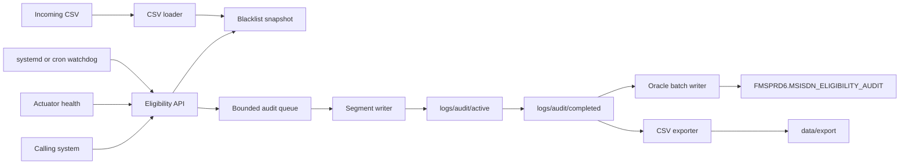

# MSISDN Eligibility Validation API

Operations and technical guide for the real-time eligibility service. The service answers whether a mobile number (MSISDN) may proceed with an operation. It decides that from an in-memory blacklist. It does not query Oracle on the request path.

This document assumes you have never seen the repository. The packaged configuration uses `/opt/msisdn-api` as a prefix. When `FMSUser` runs `scripts/install.sh`, that prefix is rewritten to `$HOME/msisdn-api`. Commands below show both forms. A developer checkout uses the classpath `src/main/resources/application.yml` and relative directories.

---

## Chapter 1 — Introduction

The API receives one MSISDN and returns `OK` or `KO`.

It exists so a calling system can reject numbers that appear on a daily fraud blacklist before it performs a business operation. The check has to stay fast at about 500 requests per second, so the blacklist is loaded into memory and the request thread only reads that memory.

An MSISDN is stored and returned as a string. The default rule is a 12-digit Egyptian number that starts with `20`, for example `201066257228`.

Eligibility:

- The number is not in the active snapshot: `OK`, with an empty reason list.
- The number is in the snapshot and every source flag is `0`: `OK`.
- The number is in the snapshot and one or more source flags are `1`: `KO`. Every active source is returned as a human-readable reason.

The blacklist is a CSV. The first column is `MSISDN`. Every following column is a source. A `1` means that source applies. A `0` means it does not. Source names come from the header. Display names come from configuration, for example `Vishing` becomes `Anti-Fraud (Vishing)`.

A valid decision is HTTP 200. A malformed request is HTTP 400. The service returns HTTP 503 when it has no usable blacklist, when the audit queue cannot accept the event, or when free disk space is below the configured floor. An unexpected failure is HTTP 500. The service never returns `OK` because the blacklist failed to load.

Each accepted request gets one request id. That id is the HTTP response field `requestId`, the response header `X-Request-Id`, the audit JSON line, the CSV export row, and the Oracle primary key `REQUEST_ID`.

---

## Chapter 2 — Architecture



Components:

- **REST API.** Spring MVC on embedded Tomcat. `POST /api/v1/eligibility/check` validates the body and reads the snapshot once.
- **Blacklist engine.** A `Long2LongOpenHashMap`. The key is the numeric MSISDN. The value is a 64-bit source mask. No per-number object is allocated.
- **CSV loader.** Univocity reads the file. Invalid files are moved to the rejected directory and the previous snapshot stays active.
- **Bitmask decoder.** Bit 0 is the first source column. Bit 63 is the sign bit of a Java `long` and is handled as an unsigned mask. More than 64 sources rejects the file.
- **Snapshot manager.** `AtomicReference<BlacklistSnapshot>`. A published snapshot is never mutated. Lookups take one volatile read and then run without a global lock.
- **Audit queue.** `ArrayBlockingQueue`. Default capacity 65536. Offer waits up to `overflow-timeout-ms` when the policy is `block-with-timeout`. If the offer fails, the API returns HTTP 503. Events are not dropped.
- **Audit file writer.** Background workers append JSON Lines to a segment, fsync on the flush interval, and rotate by size or age. Only a finalized segment is visible to downstream consumers.
- **Oracle batch writer.** A background thread reads completed segments with JDBC batch inserts into `FMSPRD6.MSISDN_ELIGIBILITY_AUDIT`. The runtime account is `MSISDN_API`.
- **CSV exporter.** An independent background thread writes the same completed segments to rotated CSV files. A file is published by renaming a `.part` file.
- **Health monitoring.** Liveness stays up when Oracle is down or the blacklist is stale. Readiness goes down in those cases. The cron watchdog restarts only after repeated liveness failures.
- **Watchdog.** systemd is the process supervisor. The optional cron script calls `systemctl` when the unit is enabled. It does not start a second JVM.

Request lifecycle:

1. The API-key filter runs when `security.enabled` is true. Probes stay open. A rejected key is HTTP 401 and is not audited.
2. The traffic gate checks readiness, audit-writer health, disk space, and queue utilization. Failure is HTTP 503.
3. The body is validated. A bad MSISDN is HTTP 400. That rejection is still audited when the queue accepts it. If the queue rejects the audit event, the client receives HTTP 503 instead of 400.
4. The service reads the snapshot once, looks up the number, and decodes set bits into display names.
5. The audit event is offered to the queue. The HTTP thread does not write to Oracle or to the export directory.
6. The response is HTTP 200 with `result` `OK` or `KO`.

Background lifecycle:

1. On startup, interrupted active segments are split into complete lines and a quarantined tail.
2. Audit writers start, then the Oracle writer, then the CSV exporter.
3. The loader restores the last snapshot or loads a stable incoming file. Tomcat accepts traffic only after this startup phase begins; readiness stays down until a fresh snapshot exists.
4. A scheduler scans the incoming directory on `blacklist.reload-interval` and archives segments that both consumers have finished.
5. On shutdown, Tomcat stops first. Writers drain, the Oracle thread processes what is already on disk, then the CSV thread stops.

Durability boundary: a record is durable only after it is in a finalized audit segment and the operating system has flushed it. Records still in the queue, or in a file the kernel has not flushed, can be lost if the JVM or the host dies. This service does not claim otherwise.

---

## Chapter 3 — Project Structure

```text
pom.xml                         Maven build, Java 17, Spring Boot 3.5.3
README.md                       Short entry point
docs.md                         This guide
config/application.yml          Production external configuration
config/log4j2-spring.xml        Production Log4j2 configuration
src/main/java/com/company/msisdn
src/main/resources/application.yml   Classpath defaults for local runs
sql/                            Oracle DDL and operational SQL
scripts/                        RHEL start, stop, watchdog, install
deploy/                         systemd unit and crontab example
samples/                        Sample blacklist and HTTP requests
tests/manual-testing.md        Step-by-step manual tests
tests/load-test.js              k6 script
release/                        Deployable tree, including the JAR
```

Java packages:

| Package | Responsibility |
|---|---|
| `com.company.msisdn` | `Application` entry point. DataSource auto-configuration is excluded. |
| `config` | Typed `@ConfigurationProperties`, startup checks, directory creation, lifecycle ordering. |
| `controller` | Eligibility and system-status HTTP endpoints. |
| `service` | MSISDN validation and the eligibility decision. |
| `blacklist` | CSV parse, bitmask, immutable snapshot, atomic store, reload. |
| `audit` | Queue, JSONL segments, recovery, checkpoints, archive. |
| `oracle` | HikariCP, batched idempotent insert, ingestion loop. |
| `export` | CSV publication and its own checkpoint. |
| `dto` | Request, response, error, and status records. |
| `exception` | 400, 401, 503, and 500 mapping. |
| `monitoring` | Readiness, traffic gate, disk guard, health indicators. |
| `security` | Request id and API-key filters. |
| `util` | Atomic rename, checksums, masking, identifier checks, retry backoff. |

---

## Chapter 4 — Requirements

| Requirement | Value |
|---|---|
| Java | 17, tested with OpenJDK 17.0.20.1. The enforcer rejects 18 and newer. |
| Operating system | RHEL 8 or RHEL 9 for the supplied unit and scripts. Bash 4.4 or newer. |
| Build | Maven 3.8 or newer, only on a build host. |
| CPU | Two cores can serve the lookup. Four cores leave room for reload, audit, and GC. This is an estimate, not a measured capacity. |
| Memory | The production map is sized for 12,000,000 slots at load factor 0.75, which rounds up to 16,777,216 entries. A second map exists while a new file loads. Start with `-Xms2g -Xmx4g`. Measure a 10-million-row file on the target host before go-live. The 2–4 GB figures are estimates. |
| Disk | Incoming CSV, one snapshot copy, audit segments, Oracle backlog, and CSV export. Plan for the CSV size plus at least 36 hours of audit at the real request rate. The readiness floor defaults to 1 GiB free on `/opt/msisdn-api`. |
| Network | Inbound HTTP on port 8080 from the calling network. Outbound TCP to the Oracle listener. No Redis, Kafka, or extra brokers. |
| Oracle | A reachable service, schema owner `FMSPRD6`, runtime user `MSISDN_API` with `CREATE SESSION`, `INSERT`, and `SELECT` only. |
| Permissions | `FMSUser` owns `$HOME/msisdn-api` and does not need sudo. The env file mode is 600. A root install under `/opt/msisdn-api` remains available for an administrator. |

---

## Chapter 5 — Building the Project

On the build host:

```bash
/usr/lib/jvm/java-17-openjdk-amd64/bin/java -version
mvn -version
export JAVA_HOME=/usr/lib/jvm/java-17-openjdk-amd64
export PATH="${JAVA_HOME}/bin:${PATH}"
java -version
mvn clean verify
```

`java -version` must print 17. If `JAVA_HOME` points at 21, Maven compiles with 21 and the enforcer fails.

`mvn clean verify` compiles, runs the unit and Spring tests, and writes `target/msisdn-api.jar`. That JAR is a Spring Boot executable. It contains the application classes and the runtime dependencies, including the Oracle JDBC driver.

Assemble the release tree from a verified JAR:

```bash
mkdir -p release/config release/sql release/scripts release/deploy release/tests
cp target/msisdn-api.jar release/msisdn-api.jar
cp config/application.yml release/application.yml
cp docs.md README.md release/
cp config/log4j2-spring.xml release/config/
cp sql/* release/sql/
cp scripts/*.sh release/scripts/
cp deploy/* release/deploy/
cp tests/manual-testing.md release/tests/
chmod 755 release/scripts/*.sh
```

The release tree must not contain `msisdn-api.env`, passwords, or API keys. `application.yml` references `${ORACLE_PASSWORD}` and `${MSISDN_API_KEY}` and does not embed them.

---

## Chapter 6 — Installing on RHEL

`FMSUser` does not use sudo. systemd system units, `/opt`, and `useradd` all require an administrator, so the supported install for this account is a directory it already owns.

1. Confirm Java 17 is already on the host and executable by `FMSUser`:

```bash
java -version
```

The first line must contain version 17. If `java` is a different version, set `JAVA_HOME` in the env file to a JDK 17 directory `FMSUser` can execute. Do not install a JDK under `/opt` yourself; that directory is not writable.

2. Copy the `release/` directory to a place `FMSUser` can read, for example `$HOME/release`.
3. From that directory, as `FMSUser`:

```bash
scripts/install.sh
```

The default target is `$HOME/msisdn-api`. Override it with `TARGET_DIR` only when that path is writable by `FMSUser`:

```bash
TARGET_DIR=$HOME/apps/msisdn-api scripts/install.sh
```

The script copies the JAR, configuration, SQL, and scripts, creates the data and log directories, and rewrites every `/opt/msisdn-api` path in the installed YAML, Log4j2 file, and docs to the target directory. It writes `$HOME/msisdn-api/msisdn-api.env` only when that file does not already exist. It does not call `systemctl` and does not change ownership to another user.

4. Edit `$HOME/msisdn-api/msisdn-api.env`. Set `ORACLE_JDBC_URL`, `ORACLE_USERNAME`, `ORACLE_PASSWORD`, and `MSISDN_API_KEY`. Leave `USE_SYSTEMD=false`.
5. Confirm `$HOME/msisdn-api/application.yml` now points at `$HOME/msisdn-api/data` and `$HOME/msisdn-api/logs`.
6. Ask a DBA to run the SQL in Chapter 11 as `FMSPRD6`. `FMSUser` does not need a database administrator login. The application does not create the table.
7. Publish the first blacklist into `$HOME/msisdn-api/data/blacklist/incoming`, then create the `.ready` marker. Readiness stays down until a valid file is loaded.
8. Start the process and install the watchdog as `FMSUser`:

```bash
$HOME/msisdn-api/scripts/start.sh
$HOME/msisdn-api/scripts/setup-cron.sh
crontab -l
```

9. Check health:

```bash
curl -fsS --max-time 5 http://127.0.0.1:8080/actuator/health/liveness
curl -fsS --max-time 5 http://127.0.0.1:8080/actuator/health/readiness
```

Port 8080 does not require root. If it is already taken, change `server.port` in `application.yml` and `HTTP_PORT` in `msisdn-api.env` together, then run `scripts/restart.sh`.

The cron watchdog is the process supervisor for `FMSUser`. A user crontab survives an SSH logout and a host reboot, as long as the host allows cron for that account. `nohup` in `start.sh` keeps the JVM running after you disconnect.

An administrator who can become root may still install to `/opt/msisdn-api` and enable `deploy/msisdn-api.service`. `FMSUser` should not do that, and the shell scripts ignore systemctl when they are not running as root, so they will not fail by trying to manage a unit they cannot control.

Put TLS in front of the process. Terminate TLS at a reverse proxy or a load balancer and forward HTTP to `127.0.0.1:8080`. The embedded server speaks HTTP.

---

## Chapter 7 — Configuration Reference

Production values live in the installed `application.yml`, loaded with `--spring.config.additional-location`. For `FMSUser` that file is `$HOME/msisdn-api/application.yml`. The packaged defaults still say `/opt/msisdn-api` until `install.sh` rewrites them. The classpath file remains inside the JAR for local runs. External keys override the classpath.

Every YAML change requires a process restart. Publishing a new blacklist CSV into the incoming directory does not. Credentials are environment variables, read from `msisdn-api.env` by systemd and by the shell scripts.

Startup validation rejects an empty API key when security is enabled, a blank Oracle password when Oracle audit is enabled, a freshness warning threshold above `blacklist.freshness.max-age`, an illegal schema or table identifier, and an unknown charset.

### Server

| Key | Purpose | Default | Allowed | Restart |
|---|---|---|---|---|
| `server.port` | HTTP port | `8080` | 1–65535 | yes |
| `server.address` | Bind address | `0.0.0.0` | any bindable address | yes |
| `server.shutdown` | Tomcat shutdown | `graceful` | `graceful` or `immediate` | yes |
| `server.tomcat.threads.max` | Worker threads | `200` | positive integer | yes |
| `server.tomcat.threads.min-spare` | Spare workers | `20` | integer, at most `max` | yes |
| `server.tomcat.max-connections` | Open connections | `8192` | positive integer | yes |
| `server.tomcat.accept-count` | Accept queue | `1000` | non-negative | yes |
| `server.tomcat.connection-timeout` | Socket timeout | `5s` | duration | yes |
| `server.tomcat.keep-alive-timeout` | Keep-alive | `30s` | duration | yes |
| `spring.lifecycle.timeout-per-shutdown-phase` | Graceful stop budget | `30s` | duration | yes |

### API

| Key | Purpose | Default | Allowed | Restart |
|---|---|---|---|---|
| `api.eligibility-path` | Check endpoint | `/api/v1/eligibility/check` | path | yes |
| `api.status-path` | Status endpoint | `/api/v1/system/status` | path | yes |
| `api.instance-id` | Audit column `API_INSTANCE` | `${MSISDN_INSTANCE_ID:${HOSTNAME:msisdn-api}}` | string | yes |
| `api.msisdn.pattern` | Full-match regex | `^20[0-9]{10}$` | Java regex | yes |
| `api.msisdn.min-length` | Minimum length | `12` | 1–18 | yes |
| `api.msisdn.max-length` | Maximum length | `12` | 1–18, at least min | yes |
| `api.msisdn.description` | Validation error text | Egyptian 12-digit text | string | yes |
| `api.response.eligible-value` | Eligible token | `OK` | string | yes |
| `api.response.ineligible-value` | Rejected token | `KO` | string | yes |
| `api.response.include-request-id` | Omit field when false | `true` | boolean | yes |
| `api.response.include-msisdn` | Omit field when false | `true` | boolean | yes |
| `api.response.include-reasons` | Omit field when false | `true` | boolean | yes |
| `api.response.include-blacklist-version` | Omit field when false | `true` | boolean | yes |
| `api.error.include-message` | Error detail policy | `validation-only` | `validation-only`, `always`, `never` | yes |
| `api.error.include-path` | Include request path | `true` | boolean | yes |

`validation-only` returns the validation or readiness message for HTTP 400, 415, and 503, and a generic message for HTTP 500. `always` adds the exception simple name on HTTP 500. `never` uses a generic message for every status. Length 18 is the maximum because the in-memory key is a positive signed `long`.

### Blacklist

| Key | Purpose | Default | Allowed | Restart |
|---|---|---|---|---|
| `blacklist.input-directory` | Incoming CSV directory | `/opt/msisdn-api/data/blacklist/incoming` | directory | yes |
| `blacklist.processed-directory` | Accepted files | `.../processed` | directory | yes |
| `blacklist.rejected-directory` | Rejected files | `.../rejected` | directory | yes |
| `blacklist.snapshot-directory` | Recovery copy | `.../snapshot` | directory | yes |
| `blacklist.filename-pattern` | Version regex | `blacklist-(\d{8})\.csv` | regex with one group | yes |
| `blacklist.msisdn-column` | Header of the number column | `MSISDN` | header text | yes |
| `blacklist.delimiter` | CSV delimiter | `,` | one character | yes |
| `blacklist.encoding` | File charset | `UTF-8` | charset name | yes |
| `blacklist.duplicate-policy` | Repeated MSISDN | `merge-or` | `merge-or`, `first-wins`, `last-wins`, `reject` | yes |
| `blacklist.version-selection` | Which file wins | `highest-wins` | `highest-wins` | yes |
| `blacklist.reload-interval` | Scan period | `30s` | duration | yes |
| `blacklist.sources.header-case-sensitive` | Header match | `true` | boolean | yes |
| `blacklist.sources.unknown-display-pattern` | Fallback label | `Anti-Fraud ({name})` | pattern with `{name}` | yes |
| `blacklist.sources.display-names` | Column to label map | Vishing, Suspicious_IMEI, Financial_Fraud | map | yes |
| `blacklist.ready-marker.enabled` | Require a marker | `true` | boolean | yes |
| `blacklist.ready-marker.suffix` | Marker suffix | `.ready` | suffix | yes |
| `blacklist.stability.enabled` | Wait for a stable size | `true` | boolean | yes |
| `blacklist.stability.checks` | Stable observations | `2` | integer >= 1 | yes |
| `blacklist.stability.interval` | Gap between checks | `2s` | duration | yes |
| `blacklist.validation.min-record-count` | Reject smaller files | `1` | integer >= 0 | yes |
| `blacklist.validation.max-record-count` | Reject larger files | `20000000` | integer | yes |
| `blacklist.validation.max-invalid-rows` | Tolerated bad rows | `0` | integer >= 0 | yes |
| `blacklist.validation.apply-api-msisdn-rules` | Use API regex on CSV rows | `true` | boolean | yes |
| `blacklist.validation.require-known-headers` | Reject unknown columns | `false` | boolean | yes |
| `blacklist.retention.processed-files` | Processed copies kept | `14` | integer | yes |
| `blacklist.retention.snapshot-files` | Snapshot copies kept | `3` | integer | yes |
| `blacklist.freshness.max-age` | Hard age limit | `36h` | duration | yes |
| `blacklist.freshness.fail-readiness-when-stale` | Readiness fails when older | `true` | boolean | yes |
| `blacklist.memory.initial-capacity` | Map capacity hint | `12000000` | positive integer | yes |
| `blacklist.memory.load-factor` | Fastutil load factor | `0.75` | 0 < factor < 1 | yes |

The classpath file uses `initial-capacity: 1048576` and relative `./data` paths so unit tests do not allocate the production map. Do not deploy the classpath file as the external configuration.

Age is the source file modification time stored as `publishedAt`, not the moment the process loaded it. A restart does not make an old file look new.

### Audit

| Key | Purpose | Default | Allowed | Restart |
|---|---|---|---|---|
| `audit.enabled` | Master switch | `true` | boolean | yes |
| `audit.async.enabled` | Queue instead of inline I/O | `true` | boolean | yes |
| `audit.async.queue-size` | Bound | `65536` | positive integer | yes |
| `audit.async.worker-count` | Segment writers | `1` | 1–16 | yes |
| `audit.async.overflow-policy` | Full-queue behavior | `block-with-timeout` | `block-with-timeout`, `reject-immediately` | yes |
| `audit.async.overflow-timeout-ms` | Wait before HTTP 503 | `10` | integer >= 0 | yes |
| `audit.log.directory` | Segment root | `/opt/msisdn-api/logs/audit` | directory | yes |
| `audit.log.active-subdir` | Open segments | `active` | name | yes |
| `audit.log.completed-subdir` | Immutable segments | `completed` | name | yes |
| `audit.log.archive-subdir` | Fully consumed | `archive` | name | yes |
| `audit.log.quarantine-subdir` | Truncated tails | `quarantine` | name | yes |
| `audit.rotation.max-file-size` | Size rotation | `64MB` | size | yes |
| `audit.rotation.max-file-age` | Age rotation | `15m` | duration | yes |
| `audit.flush-interval` | fsync period | `1s` | duration | yes |
| `audit.recovery.enabled` | Split interrupted files | `true` | boolean | yes |
| `audit.recovery.quarantine-truncated` | Keep the torn tail | `true` | boolean | yes |
| `audit.retention.archive-after` | Delay before archive | `24h` | duration | yes |
| `audit.retention.delete-completed-after-processed` | Move consumed files | `true` | boolean | yes |
| `audit.retention.archive-max-age` | Delete old archive | `7d` | duration | yes |
| `audit.retention.quarantine-max-age` | Delete old quarantine | `30d` | duration | yes |
| `audit.format` | Record encoding | `jsonl` | `jsonl` | yes |

### Oracle

| Key | Purpose | Default | Allowed | Restart |
|---|---|---|---|---|
| `oracle-audit.enabled` | Start the writer | `true` in production, `false` on the classpath | boolean | yes |
| `oracle-audit.jdbc-url` | Thin URL | `${ORACLE_JDBC_URL:jdbc:oracle:thin:@//localhost:1521/ORCLPDB1}` | JDBC URL | yes |
| `oracle-audit.username` | Runtime account | `${ORACLE_USERNAME:MSISDN_API}` | Oracle user | yes |
| `oracle-audit.password` | Runtime password | `${ORACLE_PASSWORD:}` | env var, never a literal in the release | yes |
| `oracle-audit.schema` | Owner | `FMSPRD6` | Oracle identifier | yes |
| `oracle-audit.table` | Audit table | `MSISDN_ELIGIBILITY_AUDIT` | Oracle identifier | yes |
| `oracle-audit.pool.maximum-pool-size` | Hikari max | `4` | positive | yes |
| `oracle-audit.pool.minimum-idle` | Hikari idle | `1` | non-negative | yes |
| `oracle-audit.pool.connection-timeout-ms` | Borrow timeout | `3000` | milliseconds | yes |
| `oracle-audit.pool.idle-timeout-ms` | Idle eviction | `600000` | milliseconds | yes |
| `oracle-audit.pool.max-lifetime-ms` | Connection lifetime | `1800000` | milliseconds | yes |
| `oracle-audit.pool.validation-timeout-ms` | Validation timeout | `2000` | milliseconds | yes |
| `oracle-audit.pool.keepalive-time-ms` | Keepalive | `120000` | milliseconds | yes |
| `oracle-audit.pool.initialization-fail-timeout-ms` | Startup if Oracle is down | `-1` | `-1` continues | yes |
| `oracle-audit.batch.size` | Rows per batch | `1000` | positive | yes |
| `oracle-audit.batch.flush-interval-ms` | Partial-batch wait | `1000` | milliseconds | yes |
| `oracle-audit.retry.max-attempts` | Attempts per batch | `8` | positive | yes |
| `oracle-audit.retry.initial-backoff-ms` | First wait | `500` | milliseconds | yes |
| `oracle-audit.retry.max-backoff-ms` | Cap | `60000` | milliseconds | yes |
| `oracle-audit.retry.multiplier` | Backoff growth | `2.0` | number > 1 | yes |
| `oracle-audit.network.connect-timeout-ms` | TCP connect | `5000` | milliseconds | yes |
| `oracle-audit.network.read-timeout-ms` | Socket read | `30000` | milliseconds | yes |
| `oracle-audit.network.query-timeout-seconds` | Statement timeout | `30` | seconds | yes |
| `oracle-audit.checkpoint-directory` | Ingestion checkpoint | `/opt/msisdn-api/data/checkpoints/oracle` | directory | yes |
| `oracle-audit.poll-interval` | Idle poll | `2s` | duration | yes |

`initialization-fail-timeout-ms: -1` means the pool does not fail application startup when the listener is down. The backlog stays in completed segment files.

### CSV export

| Key | Purpose | Default | Allowed | Restart |
|---|---|---|---|---|
| `csv-export.enabled` | Start the exporter | `true` | boolean | yes |
| `csv-export.destination-directory` | Published CSV directory | `/opt/msisdn-api/data/export` | directory | yes |
| `csv-export.filename-prefix` | File prefix | `eligibility-audit` | filename token | yes |
| `csv-export.delimiter` | Field separator | `,` | one character | yes |
| `csv-export.include-header` | Header row | `true` | boolean | yes |
| `csv-export.encoding` | Output charset | `UTF-8` | charset | yes |
| `csv-export.max-file-size` | Rotate by size | `64MB` | size | yes |
| `csv-export.max-file-age` | Rotate by age | `15m` | duration | yes |
| `csv-export.checkpoint-directory` | Export checkpoint | `/opt/msisdn-api/data/checkpoints/csv` | directory | yes |
| `csv-export.poll-interval` | Idle poll | `2s` | duration | yes |
| `csv-export.formula-injection-protection` | Prefix formula cells | `true` | boolean | yes |
| `csv-export.retry.max-attempts` | Attempts | `8` | positive | yes |
| `csv-export.retry.initial-backoff-ms` | First wait | `500` | milliseconds | yes |
| `csv-export.retry.max-backoff-ms` | Cap | `60000` | milliseconds | yes |
| `csv-export.retry.multiplier` | Growth | `2.0` | number > 1 | yes |

### Monitoring and security

| Key | Purpose | Default | Allowed | Restart |
|---|---|---|---|---|
| `monitoring.blacklist-freshness-threshold` | Warning age | `36h` | duration, at most `max-age` | yes |
| `monitoring.audit-queue-warning-threshold` | Log warning | `0.8` | 0–1 | yes |
| `monitoring.audit-queue-readiness-threshold` | Refuse traffic | `0.99` | 0–1 | yes |
| `monitoring.disk-space-threshold-bytes` | Free-space floor | `1073741824` | bytes | yes |
| `monitoring.disk-path` | Filesystem to measure | `/opt/msisdn-api` | path | yes |
| `monitoring.oracle-backlog-threshold` | Status warning | `100000` | count | yes |
| `monitoring.csv-backlog-threshold` | Status warning | `100000` | count | yes |
| `security.enabled` | Require an API key | `true` in production, `false` on the classpath | boolean | yes |
| `security.api-key-header` | Header name | `X-API-Key` | header token | yes |
| `security.api-key` | Expected key | `${MSISDN_API_KEY:}` | env var | yes |
| `security.protect-actuator` | Protect metrics | `true` | boolean | yes |
| `security.unprotected-paths` | Open paths | liveness and readiness | path list | yes |

Actuator exposure is `health,info,metrics,prometheus`. Health details are `never`, including on the probes.

---

## Chapter 8 — Blacklist Management

CSV shape:

```csv
MSISDN,Vishing,Suspicious_IMEI,Financial_Fraud
201066257228,1,0,1
201012345678,0,1,1
201098765432,1,0,0
```

The loader reads the header from the first record. A byte-order mark is stripped. The number of source columns is whatever follows `MSISDN`, up to 64. Column order is the bit order. Bit 0 is the first source. Bit 63 is stored as `Long.MIN_VALUE` and compared with an unsigned test. A 65th source rejects the file.

`display-names` maps a header to the reason text. An unknown header uses `unknown-display-pattern`, with underscores replaced by spaces, unless `require-known-headers` is true. In that case the file is rejected.

Duplicate MSISDNs:

- `merge-or` combines flags with bitwise OR.
- `first-wins` keeps the first row.
- `last-wins` keeps the last row.
- `reject` fails the file.

Flags other than `0` or `1`, a bad MSISDN, a duplicate header, or a missing number column count as invalid rows. With `max-invalid-rows: 0` the file is rejected. Rejected files move to the rejected directory together with a `.reason.txt`. The active snapshot is left in place.

Version is the first capture group of `filename-pattern`. The default is `blacklist-YYYYMMDD.csv`. A lower version never replaces a higher one. The same version with the same SHA-256 is moved to processed and not reloaded. The same version with a different checksum is a same-day correction and replaces the snapshot.

Publication:

1. Copy the CSV into the incoming directory. Do not create the marker yet.
2. When the copy is complete, create `blacklist-YYYYMMDD.csv.ready`.
3. With stability enabled, the first observation is never loaded. The file must show the same size and checksum across `checks` observations.
4. The loader builds a new map, trims it, writes a snapshot copy, and swaps the `AtomicReference`.
5. Confirm with `GET /api/v1/system/status`. `blacklist.version` equals the filename date and `blacklist.recordCount` equals the accepted rows.

Startup loads the snapshot directory when its checksum matches the metadata. If that copy is missing, the loader waits for an incoming file. Readiness stays down until then. There is no empty-map success path.

Manual reload check: publish a new file as above and wait one `reload-interval` plus the stability window. Do not restart the process. Chapter 20 and `tests/manual-testing.md` test 11 give the commands.

---

## Chapter 9 — API Usage

```http
POST /api/v1/eligibility/check
Content-Type: application/json
X-API-Key: <MSISDN_API_KEY>
```

Request:

```json
{"msisdn":"201066257228"}
```

Blacklisted:

```json
{
  "requestId": "req-001",
  "msisdn": "201066257228",
  "result": "KO",
  "reasons": ["Anti-Fraud (Vishing)", "Anti-Fraud (Financial Fraud)"],
  "blacklistVersion": "20261015"
}
```

Eligible:

```json
{
  "requestId": "req-002",
  "msisdn": "201055555555",
  "result": "OK",
  "reasons": [],
  "blacklistVersion": "20261015"
}
```

The real `requestId` is `req-` plus a UUID. Unknown JSON properties are rejected.

```bash
curl -sS -D - http://127.0.0.1:8080/api/v1/eligibility/check \
  -H 'Content-Type: application/json' \
  -H "X-API-Key: ${MSISDN_API_KEY}" \
  -d '{"msisdn":"201066257228"}'
```

Errors:

| HTTP | When |
|---|---|
| 400 | Missing body, unknown property, MSISDN fails the pattern, wrong type. |
| 401 | Security is enabled and the key is missing or wrong. Not audited. |
| 415 | Unsupported media type. |
| 503 | No fresh snapshot, queue full after the overflow timeout, disk below the floor, audit writer dead. |
| 500 | Unexpected exception. The body does not include the stack. |

`samples/api_requests.http` contains the same calls for an HTTP client. Authentication is the shared API key. There is no end-user login. Restrict the key to the calling system and rotate it by changing `MSISDN_API_KEY` and restarting.

Operational status:

```bash
curl -sS http://127.0.0.1:8080/api/v1/system/status \
  -H "X-API-Key: ${MSISDN_API_KEY}"
```

The body contains version, uptime, blacklist version and counts, queue size and utilization, and Oracle and CSV writer status. It does not contain the API key, the database password, or the JDBC URL.

---

## Chapter 10 — Audit Logging

The HTTP thread offers an `AuditEvent` to a bounded queue and returns. One worker, by default, appends a JSON object and a newline.

```json
{"requestId":"req-001","requestTimestamp":"2026-10-15T00:00:00Z","responseTimestamp":"2026-10-15T00:00:00.001Z","msisdn":"201066257228","result":"KO","reasonMask":"5","reasons":["Anti-Fraud (Vishing)","Anti-Fraud (Financial Fraud)"],"blacklistVersion":"20261015","processingTimeMs":1,"httpStatus":200,"apiInstance":"msisdn-api"}
```

`reasonMask` is the unsigned decimal form of the bitmask. Mask `5` is bits 0 and 2.

Directories:

```text
logs/audit/active/       the file currently being appended
logs/audit/completed/    closed segments, safe to read
logs/audit/archive/      both consumers finished, and archive-after elapsed
logs/audit/quarantine/   the torn tail of a crashed segment
```

Rotation closes the active file when it reaches `max-file-size` or `max-file-age`, fsyncs it, and moves it to `completed` with an atomic rename. Segment names include the worker id and a timestamp so two files cannot collide.

On startup, recovery copies every complete line of an active file to `completed/recovered-*` and writes a trailing partial line to quarantine. Downstream jobs read only `completed`.

Checkpoints are small JSON files. They are fsynced and then atomically moved. Oracle and CSV keep separate checkpoints. A segment is archived only after both enabled consumers have recorded completion and `archive-after` has elapsed. A disabled consumer counts as finished. The file is not deleted merely because one consumer succeeded.

Overflow: the offer waits `overflow-timeout-ms` (10 ms). If no slot appears, the request fails with HTTP 503. `reject-immediately` does not wait. There is no discard policy.

Retention deletes archive files older than `archive-max-age` and quarantine files older than `quarantine-max-age`. It does not delete a completed segment that still has a consumer behind.

Loss window: a crash can lose events that were queued but not appended, and bytes that were appended but not flushed. Do not describe the queue as a durable log.

Application logs go to `logs/application` through Log4j2. An async appender with a bounded buffer wraps the rolling file. Audit segments are not that appender. MSISDNs in application logs are masked to the first four digits, stars, and the last two digits.

---

## Chapter 11 — Oracle Integration

The pool is HikariCP, created only when `oracle-audit.enabled` is true. Each new connection runs `ALTER SESSION SET TIME_ZONE = 'UTC'`. Inserts use `JdbcTemplate` batching. JPA is not on the classpath.

Table `FMSPRD6.MSISDN_ELIGIBILITY_AUDIT` columns: `REQUEST_ID`, `REQUEST_TIMESTAMP`, `RESPONSE_TIMESTAMP`, `MSISDN`, `RESULT`, `REASON_MASK`, `REASONS`, `BLACKLIST_VERSION`, `PROCESSING_TIME_MS`, `HTTP_STATUS`, `API_INSTANCE`, plus `INGESTED_AT`. `MSISDN` is `VARCHAR2`. `REASON_MASK` is `VARCHAR2(16)` holding 16 uppercase hex characters so bit 63 is not a negative `NUMBER`. `REQUEST_ID` is the primary key. No sequence is used.

Installation order, from `sql/README.md`:

```bash
sqlplus FMSPRD6@//oracle-host:1521/service @01_create_tables.sql
sqlplus FMSPRD6@//oracle-host:1521/service @02_create_indexes.sql
sqlplus FMSPRD6@//oracle-host:1521/service @03_create_sequences.sql
sqlplus / as sysdba @04_create_grants.sql
sqlplus FMSPRD6@//oracle-host:1521/service @05_verify_installation.sql
```

`03` is an intentional no-op. `04` grants `CREATE SESSION`, `INSERT`, and `SELECT` to `MSISDN_API`. Create that user before the grant, using the commented statements in `04` as a template and a password that is not stored in git. `05` prints `VERIFICATION OK` or raises `ORA-20001`.

Indexes, and why they exist:

- Primary key on `REQUEST_ID`, so replay of the same id cannot insert a second row.
- `(MSISDN, REQUEST_TIMESTAMP)` for the operational lookup by number.
- `(REQUEST_TIMESTAMP)` for time-range counts.

The insert is `INSERT ... SELECT ? ... FROM DUAL WHERE NOT EXISTS (...)`. The request id is bound twice. A batch failure falls back to row-by-row. A duplicate primary key is skipped. Any other integrity failure is quarantined with the segment position recorded. Retries use exponential backoff up to `max-backoff-ms`.

The checkpoint stores the segment name and byte offset. A crash after commit and before the checkpoint re-reads the same lines. The `NOT EXISTS` clause and the primary key make that replay safe. The backlog is the completed files, not a queue in the heap.

While Oracle is down the API keeps answering and the writer keeps retrying. Status shows `oracle.status` of `DOWN` or `DEGRADED` and a truncated `lastError` with passwords removed. Readiness does not depend on Oracle, so a database outage does not by itself stop eligibility or cause the watchdog to restart the JVM.

Queries for operations are in `sql/06_audit_queries.sql`. Retention examples are in `sql/07_maintenance.sql`. Those examples are commented. Nothing in the application deletes audit rows.

---

## Chapter 12 — CSV Export

The exporter reads the same completed segments through its own checkpoint. It writes `destination-directory/<prefix>-<timestamp>.part`, fsyncs, saves the checkpoint, and renames the part file to `.csv`. Consumers should ignore `*.part`.

Rotation follows `max-file-size` and `max-file-age`. The header row is written when `include-header` is true. Cells that start with `=`, `+`, `-`, `@`, tab, or carriage return gain a leading single quote when formula protection is on, so a spreadsheet does not execute them.

If the destination is missing or full, the source segment stays in `completed` and the exporter retries with the configured backoff. Restoring the directory is enough. The next poll continues from the checkpoint.

Recovery:

- A crash while the `.part` file is open rewrites from the last consistent checkpoint. A size mismatch deletes the part file and rewinds.
- A crash after the rename and before the checkpoint notices that the final `.csv` already exists and does not append those rows again.

Export files are the operational copy for analysts. They are not a second source of truth ahead of the audit segments. The directory is owned by `FMSUser` and mode 750. MSISDNs in these files are complete, because the export is the audit record.

---

## Chapter 13 — Starting and Stopping

`FMSUser` uses the shell scripts. They do not call `systemctl` unless the script itself is running as root, so a missing sudo password cannot block a start or a stop.

From `$HOME/msisdn-api`:

```bash
scripts/start.sh
scripts/status.sh
scripts/stop.sh
scripts/restart.sh
scripts/healthcheck.sh
```

`start.sh` takes an exclusive `flock`, refuses to launch when `/proc/<pid>/cmdline` already contains this JAR, writes `run/msisdn-api.pid`, and waits up to `STARTUP_TIMEOUT` seconds (default 180). Exit 0 means ready. Exit 2 means the process is live but not ready. Exit 1 means it failed. The script does not send `SIGKILL`.

`stop.sh` sends `SIGTERM` and waits up to `STOP_TIMEOUT` seconds (default 60). It checks the command line before signalling, so it does not kill unrelated Java processes.

`status.sh` prints the pid, liveness, readiness, and the blacklist version when the status endpoint is reachable.

`healthcheck.sh` returns 0 when liveness is up. Exit 3 means the process is gone. Exit 4 means liveness is down. A readiness failure alone returns 0, because an Oracle outage or a stale blacklist must not page a process restart.

Logs for an `FMSUser` install:

```bash
tail -f "$HOME/msisdn-api/logs/application/application.log"
tail -f "$HOME/msisdn-api/logs/application/console.log"
```

`console.log` is the shell-script redirect. `MSISDN_LOG_DIR` in the env file is what Log4j2 uses, so application logs stay under the install directory instead of `/opt/msisdn-api`. An administrator who installed the system unit can also use `journalctl -u msisdn-api -f`.

---

## Chapter 14 — Cron Watchdog

For `FMSUser` this watchdog is the supervisor. There is no systemd unit, because installing one needs root. The crontab of `FMSUser` starts the process again after a crash and after a reboot. Recovery waits until the next minute, and until the configured number of failed liveness checks.

The watchdog:

1. Takes `flock` on `run/watchdog.lock`. A second minute-trigger exits 0.
2. If the unit is enabled, it treats systemd active state as process liveness. Otherwise it reads the pid file and `/proc`.
3. When the process is up, it calls the liveness URL with a short timeout. Readiness is not consulted.
4. It restarts only after `WATCHDOG_LIVENESS_FAILURES` consecutive failures (default 3). One failed probe does not restart.
5. It will not restart during `WATCHDOG_GRACE_SECONDS` after a start (default 180) or during `WATCHDOG_COOLDOWN_SECONDS` (default 300). It stops after `WATCHDOG_MAX_RESTARTS_PER_HOUR` (default 4).
6. As `FMSUser` it runs `start.sh`. It never launches Java itself, and it does not call `systemctl`.

Cron runs once a minute. Recovery is therefore at least one minute, and three minutes with the default failure count. It is not an instant restarter.

Install and remove as `FMSUser`:

```bash
$HOME/msisdn-api/scripts/setup-cron.sh
crontab -l
$HOME/msisdn-api/scripts/uninstall-cron.sh
```

After `install.sh`, the line looks like this, with the home directory filled in:

```cron
* * * * * /home/FMSUser/msisdn-api/scripts/watchdog.sh >> /home/FMSUser/msisdn-api/logs/application/watchdog.log 2>&1
```

`setup-cron.sh` installs that line into the crontab of the user who runs it. It refuses to add a second copy. Inspect `watchdog.log` and `run/watchdog.state`. Leave `USE_SYSTEMD=false`.

---

## Chapter 15 — Monitoring

| Endpoint | Auth | Meaning |
|---|---|---|
| `GET /actuator/health/liveness` | open | Process and audit writer. UP while the JVM and the writer thread are alive. |
| `GET /actuator/health/readiness` | open | Blacklist present and fresh, audit pipeline accepting, disk above the floor. |
| `GET /actuator/health` | API key when security is on | Aggregate. Details are hidden. |
| `GET /actuator/metrics` and `/actuator/prometheus` | API key | Micrometer. Includes `audit.queue.size`. |
| `GET /api/v1/system/status` | API key | Versions, counts, queue utilization, Oracle and CSV backlog. |

Readiness contributors: `readinessState`, `blacklist`, `auditPipeline`, `diskSpace`. Liveness contributors: `livenessState`, `auditWriter`.

`blacklist.freshness` in the status payload is `FRESH`, `WARN`, or `STALE` based on `publishedAt` and the two age settings. `WARN` uses `monitoring.blacklist-freshness-threshold`. `STALE` uses `blacklist.freshness.max-age` and fails readiness when `fail-readiness-when-stale` is true.

Queue utilization above 0.8 logs a warning. At or above 0.99 the traffic gate returns HTTP 503 so the process sheds load before the offer timeout.

Oracle backlog and CSV backlog are the bytes and segment counts not yet checkpointed. Crossing `oracle-backlog-threshold` or `csv-backlog-threshold` marks that consumer degraded in the status payload. It does not restart the process.

Disk space is `File.getUsableSpace` on `monitoring.disk-path`, cached for one second, and the Actuator `diskSpace` indicator uses the same path and threshold.

JVM heap is visible through Actuator `jvm.memory.used`. The reload allocates a second map. Watch old-generation occupancy during the daily file arrival. A heap at the 4 GB ceiling during reload is a signal to measure, not a guarantee that 4 GB is enough for 10 million rows.

---

## Chapter 16 — Troubleshooting

**API not starting.** Read `$HOME/msisdn-api/logs/application/console.log`. Startup validation prints the rejected property. A missing directory is created by the application when the parent is writable. A path that still says `/opt/msisdn-api` means `install.sh` was not used; `FMSUser` cannot create that directory.

**Wrong Java version.** `scripts/start.sh` accepts only a binary whose `-version` string contains 17. Set `JAVA_HOME` in `msisdn-api.env` to a JDK 17 tree `FMSUser` can execute.

**Port already in use.** `ss -ltnp | grep 8080`. Stop the other process or change `server.port` and `HTTP_PORT` together, then restart.

**Missing configuration.** `start.sh` exits if `application.yml` is absent. systemd fails the same way when the additional location is missing.

**Invalid blacklist.** The previous snapshot stays active. The new file is under `data/blacklist/rejected` with a `.reason.txt`. Fix the CSV and publish a higher version, or the same version with a new checksum.

**Missing blacklist.** Readiness is down and eligibility returns 503 with a not-ready message. Liveness stays up. Publish a file and a `.ready` marker. Do not restart in a loop.

**Stale blacklist.** `publishedAt` is older than `freshness.max-age`. Publish today's file. Restarting does not refresh the age.

**Oracle connection failure.** Eligibility continues. `oracle.lastError` on the status endpoint and `Oracle audit batch failed` in the application log explain the outage. Confirm `ORACLE_PASSWORD`, the URL, and that `MSISDN_API` can `INSERT` into `FMSPRD6.MSISDN_ELIGIBILITY_AUDIT`. The listener recovery is automatic.

**Audit queue full.** Callers receive HTTP 503. Look for a stuck disk or a dead writer. Free space or restore the audit filesystem. The queue does not grow past `queue-size`.

**Disk full.** Readiness goes down at 1 GiB free by default. Eligibility returns 503. Delete archive files older than policy, or extend the volume. Do not delete `logs/audit/completed` while checkpoints show a remaining offset.

**CSV export failure.** Segments remain completed. Fix permissions or the mount on `csv-export.destination-directory`. The exporter retries.

**High JVM memory.** A reload holds two maps. If the process is close to `-Xmx` before the daily file arrives, raise the heap only after measuring the retained size of a real file. The 4 GB flag in the unit file is a starting estimate.

**Slow API response.** The lookup is one hash probe. Latency usually comes from GC during reload, a saturated audit queue (`overflow-timeout-ms` adds up to 10 ms), or a full Tomcat worker set. Compare `http.server.requests` percentiles with `audit.queue.size`.

**Watchdog restart loop.** Read `watchdog.log`. Cooldown and the hourly cap stop the loop. Liveness flaps when the audit writer dies or the port is blocked. Fix that cause. A stale blacklist does not increment the liveness failure counter.

**Process exits immediately.** Exit 143 is a normal SIGTERM and is a systemd success. Any other status is in the journal. An unset `MSISDN_API_KEY` with `security.enabled: true`, or an unset `ORACLE_PASSWORD` with Oracle enabled, fails startup on purpose.

---

## Chapter 17 — Recovery

**Graceful restart.** `scripts/restart.sh` sends SIGTERM. Tomcat stops, writers flush and rotate, the Oracle thread runs one pass, checkpoints move, and the new process loads the snapshot from disk.

**JVM crash.** Active segments are recovered on the next start. Complete lines are ingested. The torn last line is quarantined and is not inserted. Queued events that never reached disk are gone.

**Server reboot.** `FMSUser` cannot reboot the host. The user crontab survives a reboot performed by an administrator. On the first minute after cron starts, the watchdog sees that the process is down and runs `start.sh`. It does not require systemd.

**Oracle outage.** Completed segments accumulate. When the listener accepts connections, the writer continues from the checkpoint. Re-inserted request ids are ignored.

**Failed blacklist reload.** The new file is rejected. The previous snapshot remains the published reference. No request observes a half-built map.

**CSV destination failure.** The part file stays unpublished. After the directory returns, the exporter resumes. A part file whose size does not match the checkpoint is deleted and rewritten.

**Corrupted audit segment.** Recovery keeps only lines that end with a newline and parse as audit JSON. The remainder is quarantined. Repair is a manual decision. The service will not guess the contents of a torn line.

**Interrupted Oracle batch.** The transaction rolls back. The checkpoint stays at the previous offset. The next attempt inserts the batch again. Rows that did commit, if the crash was after commit and before the checkpoint write, hit the primary key and are skipped.

---

## Chapter 18 — Production Maintenance

Daily:

- Confirm readiness is up and `blacklist.version` is today's file.
- Confirm `oracle.status` and `csvExport.status` are `UP`, or that a known outage is still retrying.
- Confirm free space on the filesystem that holds `$HOME/msisdn-api` is comfortably above 1 GiB.
- Skim `watchdog.log` for suppressed restarts.

Weekly:

- Review rejected CSV files and quarantine.
- Check Oracle segment growth with the commented query in `sql/07_maintenance.sql`, run as `FMSPRD6`.
- Confirm archive retention is actually deleting files older than `archive-max-age`.

Log retention is the audit archive age (7 days) and Log4j2 rolling policy on `logs/application`. Those are independent. Quarantine is kept 30 days so a torn line can be inspected.

Disk cleanup may remove `data/blacklist/processed` files beyond `retention.processed-files` and export CSV files you have already collected. It must not remove `logs/audit/completed` or `data/checkpoints` while a consumer is behind.

Blacklist validation before publication: check the header, the row count against `min-record-count` and `max-record-count`, and that flags are only `0` and `1`. Publish the marker last.

Oracle maintenance is statistics and, when legal and approved, partition or archive moves written by a DBA. The application account cannot delete rows. `sql/07_maintenance.sql` keeps destructive statements commented and warns that they remove production audit history.

Updating the JAR as `FMSUser`:

```bash
cp "$HOME/msisdn-api/msisdn-api.jar" "$HOME/msisdn-api/msisdn-api.jar.prev"
"$HOME/msisdn-api/scripts/stop.sh"
cp msisdn-api.jar "$HOME/msisdn-api/msisdn-api.jar"
"$HOME/msisdn-api/scripts/start.sh"
```

Rolling back is the same stop, copy `msisdn-api.jar.prev` back to `msisdn-api.jar`, and start. Configuration and checkpoint directories stay in place, so Oracle and CSV resume from the last offset. Do not start two versions at once.

---

## Chapter 19 — Performance

A lookup is one `Long2LongOpenHashMap.get` on a map that is not mutated after publication. Average cost is constant in the number of rows. The response cost is dominated by JSON encoding and the audit offer, not by the blacklist.

Memory: keys and values are primitive longs. A 10-million-row map is on the order of a few hundred megabytes for the table itself, plus Fastutil's load-factor slack and the second map during reload. The production `initial-capacity` of 12,000,000 at load factor 0.75 asks Fastutil to size the table for that load without resizing through the file. Treat heap flags as estimates until you load a real 10-million-row file and record `jvm.memory.used`.

The audit queue holds at most 65,536 events. Each event is one small object graph. It is bounded. It is not the place where a multi-hour Oracle outage is stored. That backlog is on disk.

Oracle batches 1,000 rows, or fewer if `flush-interval-ms` elapses first. A partial batch waits before the checkpoint advances, so a quiet period still commits. Full batches are not artificially delayed. Idempotent replay means a retry does not require a compensating delete.

Load tests use `tests/load-test.js`. Run them against a non-production host that has a realistic blacklist and a reachable Oracle, or with `oracle-audit.enabled: false` if you are measuring only the lookup.

```bash
k6 run -e RATE=100 -e DURATION=60s -e BASE_URL=http://127.0.0.1:8080 tests/load-test.js
k6 run -e RATE=250 -e DURATION=60s tests/load-test.js
k6 run -e RATE=500 -e DURATION=60s tests/load-test.js
k6 run -e RATE=750 -e DURATION=60s tests/load-test.js
k6 run -e RATE=1000 -e DURATION=60s tests/load-test.js
```

Set `API_KEY`, `ELIGIBLE_MSISDN`, and `BLOCKED_MSISDN`. Record successful and failed iterations, p50, p95, and p99 from the k6 summary, and sample CPU, `jvm.memory.used`, `audit.queue.size`, and the Oracle backlog from Actuator and the status endpoint during the run. Repeat one run while a new CSV is published so the second map and the atomic swap are included.

No load test was executed in the build environment. Do not copy numbers from this chapter into a capacity report. There are no measured latency figures in this repository.

---

## Chapter 20 — Manual Testing

The executable procedure is `tests/manual-testing.md`. It contains twenty tests. Each one states the objective, the prerequisites, the exact command, the expected response, how to verify it, and the pass rule.

Run them in order on a non-production host:

1. Java 17 is installed.
2. The JAR starts.
3. Liveness and readiness respond.
4. An unknown MSISDN returns `OK`.
5. One active flag returns `KO` and one reason.
6. Several flags return every reason.
7. Malformed MSISDNs return HTTP 400.
8. The audit segment contains the same request id.
9. Oracle shows that request id after the writer commits.
10. The export CSV contains the same row and no `.part` file is left as the finished output.
11. A new CSV changes a decision without a restart.
12. An invalid CSV does not replace the snapshot.
13. A restart reloads the snapshot and continues ingestion.
14. An Oracle outage leaves the API up and drains after recovery.
15. A blocked audit writer produces HTTP 503 when the queue is full.
16. An unavailable export directory recovers when it returns.
17. The watchdog restarts a killed process and does not leave two JVMs.
18. After reboot, systemd starts the unit and the watchdog does not fight it.
19. Concurrent requests return stable decisions.
20. The k6 rates in Chapter 19 are recorded, including a run during reload.

Tests 14, 15, 16, 17, and 18 disturb the process or the database. They belong on a dedicated environment. Do not inject those faults in production.

Sample data for the first checks is `samples/blacklist_sample.csv`. Publish it as `blacklist-20261015.csv` plus a `.ready` marker, using the steps in test 2 of the manual guide.
